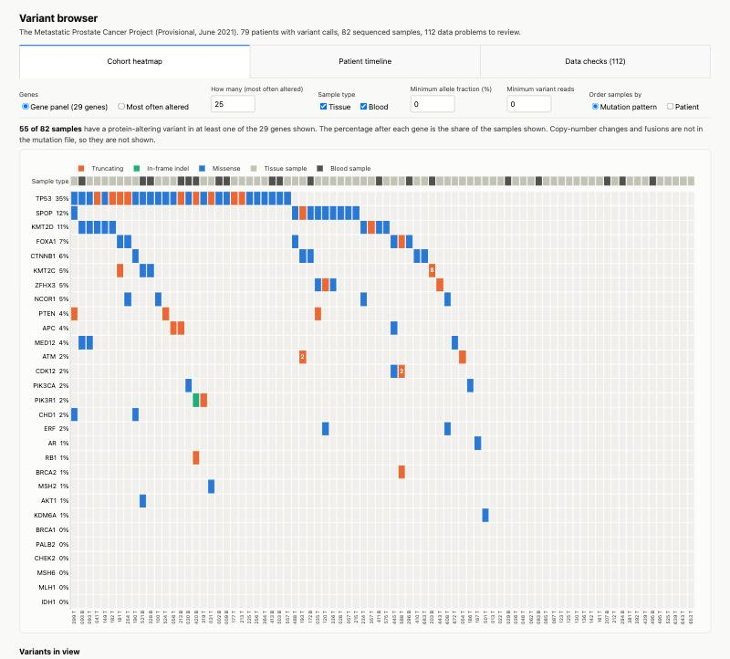
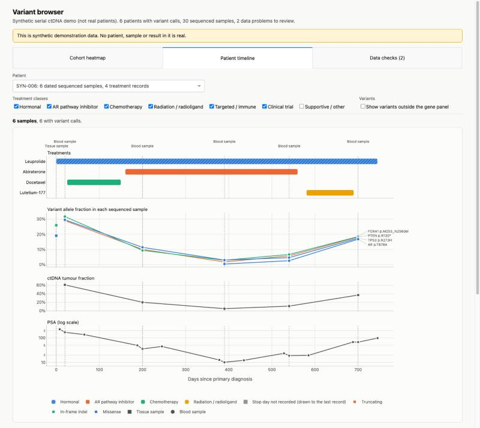
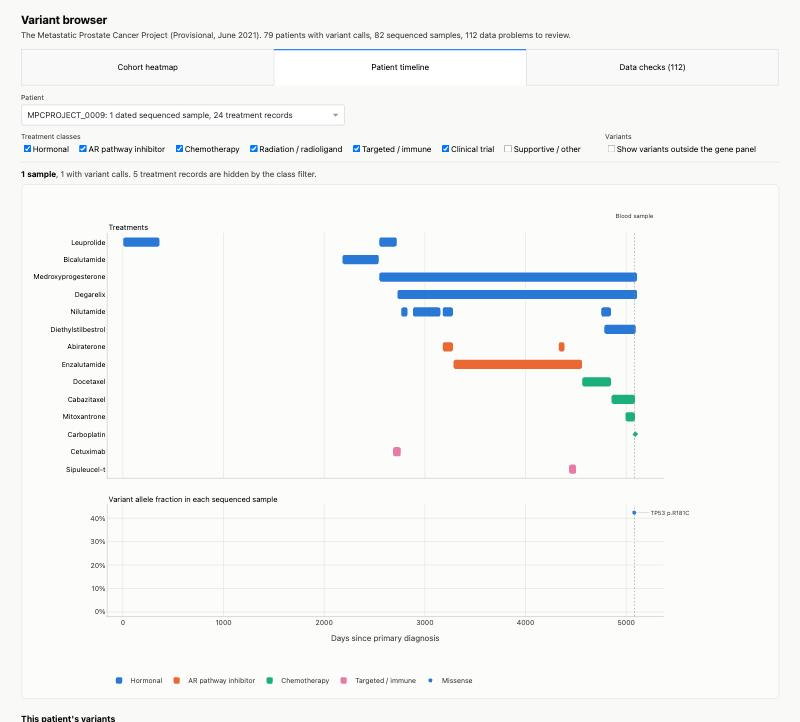

# Variant browser

A local web app for a cancer genomics lab. It reads variant calls and clinical
timelines from tab-separated files and shows them two ways:

1. **Cohort heatmap.** Genes down, samples across, one cell per gene and sample,
   coloured by the most damaging variant. Click a cell to open that patient.
2. **Patient timeline.** One patient's treatments, variant allele fractions,
   ctDNA tumour fraction and PSA on a single time axis.

A third page, **Data checks**, compares every sample and patient ID across the
input files and lists what does not agree.

It is a prototype built on public data, written in Python with Plotly and Dash.
It runs on one machine and listens on `127.0.0.1` only.







## What the data is, and is not

| Study | What it is | Used for |
|---|---|---|
| `data/raw/mpcproject_broad_2021` | The Metastatic Prostate Cancer Project (provisional, June 2021), a public cohort from the cBioPortal datahub: 97 patients, 123 samples, 82 of them exome-sequenced, 18,539 somatic calls. | The heatmap, and checking the loader against real, untidy files. |
| `data/synthetic_serial` | Six invented patients, each with a tissue sample and three to five plasma samples. Generated by `scripts/make_synthetic_demo.py` with a fixed seed. | The timeline view, and the ID checks. |

The public cohort has only three patients with more than one sequenced sample,
and 50 of its 82 sequenced samples have no collection day in the sample table.
It cannot show the same variant followed through treatment. The synthetic study
exists to show that, and nothing else: **no patient, date or measurement in it
is real**, and the app says so in a banner whenever it is loaded.

Neither study is any lab's own data.

## Quick start

Needs Python 3.12 and [uv](https://docs.astral.sh/uv/).

```bash
make setup       # virtual environment and dependencies
make data        # download the public cohort, about 80 MB
make run         # http://127.0.0.1:8050
```

```bash
make run-demo    # synthetic study at http://127.0.0.1:8051
make test        # 46 tests, about a second
```

Loading the public cohort and running the checks takes about 0.2 s on a laptop.

## Reading the views

**Heatmap.** Blue is missense, orange is truncating (nonsense, frameshift,
splice site, lost start or stop), green is an in-frame indel. A number in a cell
is the count of variants in that gene in that sample; the colour is the most
damaging one. The percentage after a gene is the share of the samples shown.
Samples are sorted so that co-occurring and exclusive genes are easy to see.
Silent, intronic and UTR calls are left out. The table under the chart lists
every variant in view and downloads as CSV.

**Timeline.** Treatments are bars, grouped by class. A hatched bar has no
recorded stop day and is drawn to the patient's last record. Dotted vertical
lines mark sample collection and run through every panel. In the variant panel a
circle is a plasma sample and a square is tissue; a line joins the same variant
across plasma samples only, because tissue and plasma allele fractions measure
different things. PSA is on a log scale; an open circle is a result reported as
below a limit, such as `<0.05`.

Each measure has its own panel. Nothing is drawn against a second y-axis.

## Data checks: matching samples to patients

The sample table says which patient each sample belongs to. The app does not
trust it blindly and does not quietly repair it. It compares the table against
the patient ID inside the sample ID, the tumour and matched-normal IDs in the
mutation file, and the specimen and treatment timelines, then reports each
disagreement with a code:

| Code | Meaning |
|---|---|
| `PATIENT_CONFLICT` | Sample table and sample ID name different patients. |
| `TIMELINE_PATIENT_CONFLICT` | Specimen timeline lists the sample under another patient. |
| `NORMAL_MISMATCH` | Matched normal belongs to a different patient than the tumour. |
| `SAMPLE_NOT_IN_TABLE` | In the mutation file or timeline, not in the sample table. |
| `NEAR_DUPLICATE_ID` | Two IDs differ only by case, spaces or punctuation. |
| `UNKNOWN_PATIENT`, `PATIENT_NOT_IN_TABLE` | A patient ID with no row in the patient table. |
| `DAY_CONFLICT`, `NO_COLLECTION_DAY` | Collection day disagrees between files, or is missing. |
| `DAY_UNPARSEABLE`, `LAB_UNPARSEABLE`, `STOP_BEFORE_START`, `AGENT_SPELLING` | Problems in single rows. |

A person then decides, and records the decision in an overrides file:

```
sample_id          same_as            patient_id   note
syn003-cfdna-c3    SYN-003_cfDNA_C3                Same tube, ID retyped by the provider
SYN-001_cfDNA_C5                      SYN-001      Missing from the sample table; checked in the lab book
```

```bash
.venv/bin/python -I -m variant_browser.app --study <dir> --overrides <file.tsv>
```

A sample with no confirmed patient is listed on the checks page and left out of
both views. A suggestion from an ID rule is shown as a proposal, never applied.

What the checks found in the public cohort, with no errors and these warnings:

- 62 patient IDs in the treatment timeline with no row in the patient table.
- 38 sequenced samples with no collection day in either file.
- 5 samples in the specimen timeline that are not in the sample table.
- 3 treatments that stop before they start, and 2 samples whose collection day
  differs between the sample table and the specimen timeline.
- 1 stop day that reads `#VALUE!`, a spreadsheet error. Reading the file with
  pandas' `comment="#"` cuts that row off and loses the drug name; the loader
  here skips only the leading `#` rows.
- 1 PSA result of `2-3`, which is not plotted. 60 results such as `<0.1` are
  read as below a limit; 89 spellings of drug names were merged into 68.

The synthetic study has six planted problems, listed in
`data/synthetic_serial/SYNTHETIC.txt`. The tests check that each is found, and
that the example overrides clear exactly the ones they address.

## Using it with other data

The loader expects the cBioPortal file layout:

| File | Content |
|---|---|
| `data_clinical_patient.txt` | One row per patient. |
| `data_clinical_sample.txt` | One row per sample: patient, collection day, site, tumour fraction. |
| `data_mutations.txt` | Variant calls in MAF format. |
| `data_timeline_treatment.txt`, `data_timeline_psa.txt`, `data_timeline_sample.txt` | Dated events. |

Things to change without touching the views:

- **Different column names.** Only `src/variant_browser/io.py` knows source
  column names. Each `_load_*` function maps them to the names used elsewhere.
- **Different sample ID scheme.** Add a pattern to `config/study.toml`.
- **Gene panel.** `config/gene_panel.txt`, one symbol per line.
- **Treatment classes.** `config/treatment_classes.tsv`, drug name and class.
  A drug not listed is drawn as "Supportive / other".

## Code map

| Module | Does |
|---|---|
| `io.py` | Reads the files into tidy tables. Parses lab results and drug names. |
| `matching.py` | The ID checks, the overrides file, and the sample table the views use. |
| `variants.py` | Filters to protein-altering calls; shapes them for the heatmap and timeline. |
| `figures.py` | Builds the two Plotly figures. Pure functions, no Dash, no file access. |
| `app.py` | The Dash layout and callbacks, and the command line. |

Dash was chosen over a separate JavaScript front end so that the whole app is
Python, which is what the people who would maintain it in a lab already write.

## Limits

- **Mutations only.** Copy-number changes and fusions are not in the mutation
  file, so AR amplification and PTEN loss, both common in advanced prostate
  cancer, do not appear.
- **The gene panel and the treatment classes are a starting draft**, written
  without clinical training. Both need review by someone who has it.
- **Time is in days from diagnosis**, as in the public cohort, not calendar dates.
- **One sample table row per sample is assumed.** A sample ID listed twice keeps
  its first row.
- **No login.** The app is for one user on their own machine.
- **Not tested on a large cohort.** The heatmap hides its column labels above 100
  samples; nothing else has been tuned for size.
- **Light theme only.** The colours were checked for colour-vision deficiency
  with a palette validator; dark mode has not been done.

## Data licence

The Metastatic Prostate Cancer Project data is available under the ODC Open
Database License (ODbL) 1.0. It is downloaded by `scripts/fetch_data.py` from the
[cBioPortal datahub](https://github.com/cBioPortal/datahub/tree/master/public/mpcproject_broad_2021)
and is not redistributed here. See <https://www.mpcproject.org/data-release> for
how to cite it. As the study's own notice says, the data was generated in a
research laboratory and cannot be used to inform clinical decisions.
